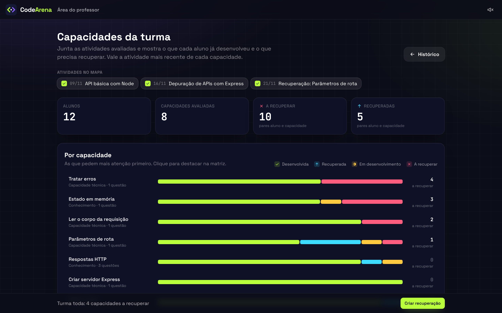
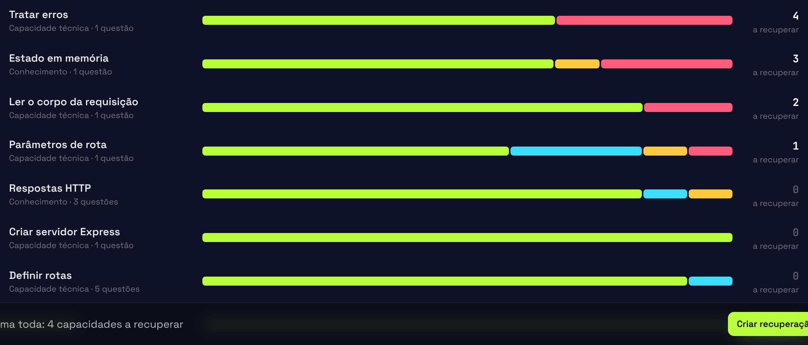
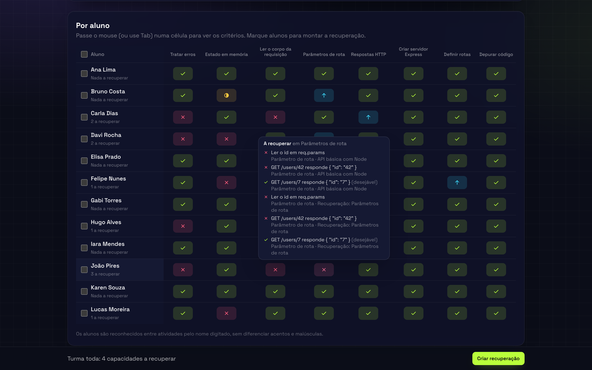
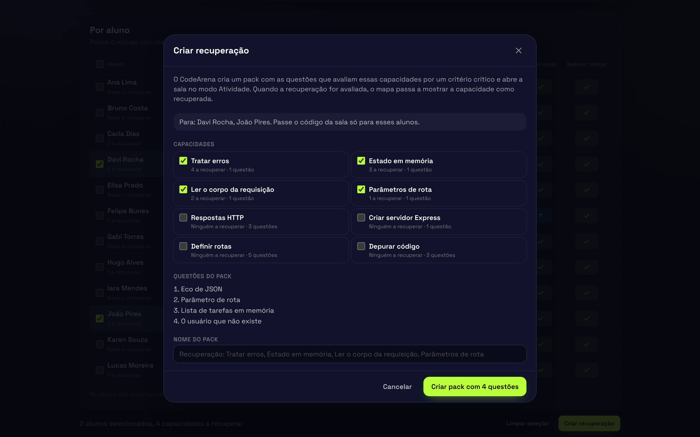

# Mapa de capacidades e recuperação

O mapa junta as atividades já avaliadas e mostra, para cada capacidade, quem já desenvolveu e quem ainda precisa
recuperar. Dele sai a recuperação direcionada: um pack só com as questões das capacidades que faltaram, pronto para abrir
como atividade.

<video class="ca-video" controls preload="metadata" aria-label="Vídeo do mapa de capacidades: o professor abre o mapa pelo histórico, vê as capacidades que pedem mais atenção, confere as evidências de um aluno e cria a recuperação" :poster="withBase('/videos/capacidades-demo-poster.jpg')">
  <source :src="withBase('/videos/capacidades-demo.mp4')" type="video/mp4" />
</video>

## Onde fica

Em **Histórico**, clique em **Capacidades da turma**. O mapa usa as atividades (modo Atividade) da sua chave que já têm
pelo menos uma avaliação. No topo, marque e desmarque as atividades que entram na conta: o mapa refaz tudo na hora.

As capacidades vêm do campo `capability` de cada critério da checklist ([critérios de atividades](../agents/activity-criteria.md)).
Use sempre o mesmo nome para a mesma capacidade em questões e atividades diferentes; maiúsculas e acentos não importam.

## As quatro situações

Cada situação tem cor, ícone e nome, então dá para ler o mapa sem depender só da cor.

| Situação | Quando aparece |
| --- | --- |
| **Desenvolvida** | o aluno atendeu todos os critérios dessa capacidade |
| **Em desenvolvimento** | atendeu os críticos, mas faltou algum desejável |
| **A recuperar** | faltou algum critério crítico na última atividade que avaliou a capacidade |
| **Recuperada** | estava a recuperar e, numa atividade depois, atendeu os críticos |

Vale a última atividade que avaliou a capacidade com um critério **crítico**. Uma questão posterior que só tenha
desejáveis dessa capacidade aparece nas evidências, mas não muda a situação.

## Por capacidade

Uma barra por capacidade, com quantos alunos estão em cada situação. As que têm mais alunos a recuperar vêm primeiro, e o
número à direita é o total a recuperar. Passe o mouse (ou o foco do teclado) num pedaço da barra para ver o número exato;
clique no nome para destacar a capacidade na matriz.

## Por aluno

A matriz tem uma linha por aluno e uma coluna por capacidade. Cada célula mostra a situação; no hover ou no foco, a dica
traz as evidências: o critério, se foi atendido, a questão e a atividade. Um traço significa que o aluno não foi avaliado
nessa capacidade.

Os alunos são reconhecidos pelo nome digitado na entrada da sala (sem diferença de maiúsculas, acentos e espaços). Se um
aluno entrou com nomes diferentes em atividades diferentes, ele aparece em duas linhas.

## Criar a recuperação

1. Marque os alunos na matriz (ou nenhum, para usar a turma toda).
2. Clique em **Criar recuperação** na barra que aparece embaixo.
3. Escolha as capacidades. Já vêm marcadas as que você destacou nas barras ou, se não destacou nenhuma, as que estão a
   recuperar para os alunos escolhidos. A lista embaixo mostra as questões que vão entrar no pack.
4. Ajuste o nome do pack, se quiser, e clique em **Criar pack com N questões**.

O pack entra na biblioteca com a etiqueta `recuperacao` e a sala abre no modo Atividade. Ele traz as questões que avaliam
as capacidades escolhidas com um critério crítico, na versão mais recente de cada uma. Passe o código da sala só para os
alunos da recuperação. Depois de avaliar essa nova atividade, o mapa passa a mostrar **Recuperada** para quem atendeu os
críticos.

A recuperação não muda a nota da atividade original: as notas continuam em cada sessão do histórico.
